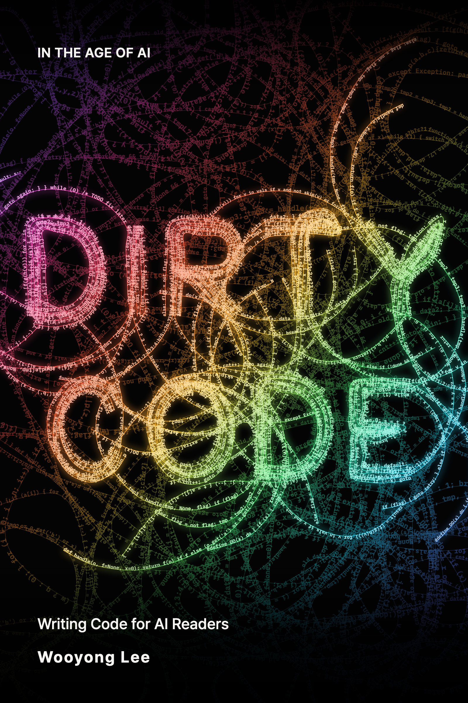

  

AI 시대

<h1 align="center">더티 코드</h1>

  <a href="README.md">English</a> &nbsp;·&nbsp; <b>한국어</b>

  <b>AI가 코드를 쓰고, 사람은 보장을 쓴다.</b> 
  사람을 위한 코드는 배웠다. 이제 AI를 위한 코드다.

 

## 보닛을 열면 덮개만 보인다

예전 차는 보닛을 열면 부품이 눈에 보였다. 벨트가 닳았는지, 어디서 기름이 새는지 눈으로 보고 렌치로 고쳤다.

요즘 차는 보닛을 열어도 플라스틱 덮개만 보인다. 눈으로 봐서는 어디가 고장인지 알 수 없다. 그 대신 운전대 아래쪽에 있는 진단 단자에 진단기를 꽂으면 "P0303, 3번 실린더 실화"처럼 고장 난 곳이 코드로 뜬다. 차를 대충 만들어서 이렇게 된 것이 아니다. 요즘 정비사는 눈으로 살피기 전에 진단기부터 꽂는다. 그래서 차도 진단기가 읽기 좋게 만든다.

코드에도 같은 일이 일어나고 있다. 오늘 내 저장소에 합쳐진 코드 가운데 내가 한 줄씩 읽은 것은 몇 줄인가. AI에게 "이 버그 고쳐 줘" 하고 맡기면, 관련된 코드를 먼저 찾아서 읽는 쪽은 내가 아니라 AI다. 이 책은 여기서 출발한다. **AI에게 일을 맡기면, 코드를 먼저 읽는 쪽은 AI다.**

『더티 코드』는 그 독자, 곧 AI가 읽고 고치기 좋게 코드를 쓰는 법을 다룬다. 그리고 코드를 한 줄씩 읽지 않게 된 사람이 그 대신 무엇을 해야 하는지를 다룬다.

> 정비사는 진단기에 뜨는 고장 코드를 **DTC**(Diagnostic Trouble Code)라고 부른다. 
> 이 책의 DTC는 **D**ir**t**y **C**ode다.

## 세 가지를 묻는다

1. **AI가 읽고 고치기 좋은 코드는 어떻게 생겼나.** 
   이름, 코드를 모으는 자리, 중복, 주석, 오류 메시지, 폴더 구조, 그리고 프롬프트를 다룬다. (2부)
2. **코드를 읽지 않는 사람은 무엇으로 품질을 보장하나.** 
   일을 나누고, 깨지면 안 되는 것을 정하고, 확인하는 방법을 설계한다. (3부)
3. **정말 그런가, 어디까지인가.** 
   같은 기능을 두 가지 모양으로 만들어 AI에게 고치게 하고 숫자로 비교한다. 사람이 코드를 직접 읽어야 하는 순간도 다룬다. (4부)

AI 도구 사용법, 모델 순위, 일자리 전망은 다루지 않는다.

## 목차

지금은 모든 장이 준비 중이다. 공개된 장에는 링크가 걸린다.

**여는 글.** 클린 코드에게: 사람을 위한 코드는 배웠다

**1부. 코드를 읽는 독자가 바뀌었다**

1. 내가 아는 길이 더 빨랐다: 개발자가 코드를 읽지 않게 된 날
2. AI는 어제 읽은 코드를 오늘 기억하지 못한다
3. 클린 코드에서 그대로 가져올 것, 달라지는 것

**2부. 진단기가 읽는 코드**

4. AI는 함수 이름을 보고 동작을 짐작한다
5. 고칠 것은 한 화면에 모아라
6. 복사해 둔 코드가 더 안전할 때
7. 주석에는 "왜"를 적는다: AI는 이유 모를 숫자를 정리해 버린다
8. 함수를 한 번 건너뛸 때마다 AI가 한 번 틀린다
9. 진단 단자를 달아라: AI가 읽는 오류와 로그
10. AI가 길을 찾는 지도: 폴더 이름과 색인 파일
11. 프롬프트도 AI가 읽는 코드다

**3부. 경고등은 사람이 단다**

12. 어디서 자를 것인가: 확인할 수 있는 크기로 맡긴다
13. 동시에 달릴 때 깨지면 안 되는 것을 사람이 정한다
14. 코드를 한 줄도 안 읽고 맞는지 확인하는 법
15. AI가 짠 코드를 AI가 검사하게 하는 법

**4부. 정말 그런가, 어디까지인가**

16. 실험: 같은 기능을 두 가지 엔진룸으로 만들어 보았다
17. 내비가 틀릴 때: 사람이 코드를 읽어야 하는 순간
18. 코드를 건너뛸 수 있을까: AI에게 기계어를 바로 쓰게 해 보았다

**닫는 글.** AI가 코드를 쓰고, 사람은 보장을 쓴다

## 모든 장은 같은 순서로 쓴다

1. **장면**: 누구나 겪어 본 상황 하나
2. **주장**: 한 문장
3. **왜 그런가**: "AI는 기억 없이 매번 처음 읽는다"에서 끌어낸다
4. **코드**: 사람을 위한 버전과 AI를 위한 버전을 나란히 놓는다
5. **프롬프트**: 같은 일을 시켰을 때 AI가 무엇을 열고 무엇을 고쳤는지 보여 준다
6. **근거**: 실험 결과 또는 현장 사례
7. **사람이 할 일**: 내일 바로 할 수 있는 것
8. **이 원칙이 깨지는 곳**: 주장이 맞지 않는 경우

## 주장에는 실험을 붙인다

- 같은 기능을 두 가지 모양으로 만든다. 기능과 테스트는 같고 코드 모양만 다르다.
- 같은 요청을 새 세션에서 열 번 이상 반복한다.
- AI에게 보여 주지 않은 판정 테스트로 성공 여부를 가린다.
- 결과에는 날짜와 모델 이름을 함께 적는다. 모델이 바뀌면 숫자도 바뀌기 때문이다.

실험 계획은 [experiments/](experiments/README.md)에 있다.

## 『클린 코드』에 대하여

로버트 C. 마틴의 『클린 코드』는 사람 독자를 위한 기준을 세웠다. 이 책은 그 책을 반박하지 않는다. 읽는 쪽이 달라졌을 때 무엇이 그대로이고 무엇이 달라지는지를 살핀다. 이름과 테스트처럼 더 중요해지는 것도 있다.

## 진행 상황

- 2026년 11월: 목차와 실험 계획을 세우고 집필을 시작했다.
- 원고는 영어로 먼저 쓴다. 한국어판은 그 뒤에 한국어 독자에 맞춰 다시 쓴다.

새 장은 이 저장소에 올라온다. 저장소 위쪽의 **Watch**를 켜 두면 소식을 받을 수 있다. **Star**는 이 책을 기다리는 독자가 얼마나 되는지 알려 준다.

---

© 2026 이우용 (Wooyong Lee). 글과 그림의 모든 권리는 저자에게 있다. 인용할 때는 출처를 밝혀 주기 바란다.
