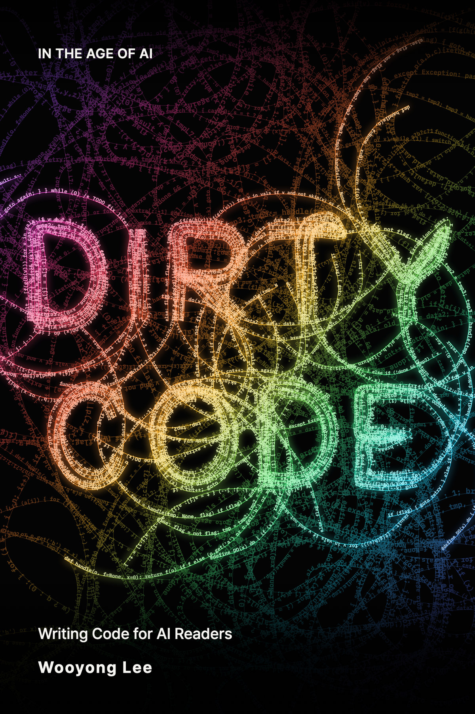

  

IN THE AGE OF AI

<h1 align="center">Dirty Code</h1>

  <b>English</b> &nbsp;·&nbsp; <a href="README.ko.md">한국어</a>

  <b>AI writes the code. People write the guarantees.</b> 
  We learned to write code for people. Now we write it for AI.

 

## Pop the hood and all you see is a cover

On an older car, you opened the hood and saw the parts. You could see a worn belt or an oil leak, and you fixed it with a wrench.

Open the hood of a modern car and you see a plastic cover. You can't tell what's wrong by looking. But plug a scan tool into the diagnostic port under the dashboard, and the fault comes up as a code, such as "P0303: cylinder 3 misfire." Nobody built the car carelessly. Mechanics now plug in the scan tool before they look, so cars are built for the scan tool to read.

The same thing is happening to code. Of the code merged into your repository today, how many lines did you read one by one? When you tell an AI "fix this bug," the one who finds the related code and reads it first is the AI, not you. This book starts there. **When you hand a task to an AI, the AI reads your code before you do.**

*Dirty Code* is about writing code that this reader, the AI, can read and change well. It is also about what people should do instead, once they stop reading code line by line.

> Mechanics call the fault codes on a scan tool **DTCs**: Diagnostic Trouble Codes. 
> In this book, DTC stands for **D**ir**t**y **C**ode.

## Three questions

1. **What does code look like when AI can read it and change it well?** 
   Names, where code lives, duplication, comments, error messages, folder structure, and prompts. (Part II)
2. **If people no longer read the code, how do they guarantee quality?** 
   They split the work, decide what must never break, and design how to check it. (Part III)
3. **Is it true, and how far does it go?** 
   We build the same feature in two shapes, ask AI to change both, and compare the numbers. We also cover the moments when people still have to read the code. (Part IV)

This book does not cover how to use AI tools, model rankings, or the future of jobs.

## Contents

Chapters are posted here as drafts while the book is being written. A linked title is a draft you can read now. The experiments were run from 2026-11-22 to 25, with Claude Code and with Codex CLI, OpenAI's coding agent, and each of Chapters 1 to 18 gives its counts in its Evidence section. Where part of an experiment wasn't run, the chapter says so.

**Preface.** [To *Clean Code*: we learned to write code for people](manuscript/en/00-preface.md) · draft

**Terms.** [The words the chapters use](manuscript/en/00a-terms.md) · draft

**Part I. The reader of your code has changed**

1. ["My way used to be faster": the day developers stopped reading code](manuscript/en/01-faster-route.md) · draft
2. [AI doesn't remember the code it read yesterday](manuscript/en/02-no-memory-reader.md) · draft
3. [What carries over from *Clean Code*, and what changes](manuscript/en/03-keep-and-change.md) · draft

**Part II. Code for the scan tool**

4. [A function that writes says so in its name](manuscript/en/04-names.md) · draft
5. [Keep what changes together on one screen](manuscript/en/05-locality.md) · draft
6. [When a copy is safer than a shared function](manuscript/en/06-duplication.md) · draft
7. [Comments say why: AI tidies up numbers it can't explain](manuscript/en/07-comments-why.md) · draft
8. [A layer that does no job today: three payment classes become one table](manuscript/en/08-indirection.md) · draft
9. [Install a diagnostic port: errors and logs for AI to read](manuscript/en/09-diagnostic-port.md) · draft
10. [AI finds code by the words in your files, and an index saves it a step](manuscript/en/10-map.md) · draft
11. [Prompts are code that AI reads](manuscript/en/11-prompts-are-code.md) · draft

**Part III. People install the warning lights**

12. [Where to cut: hand off work in pieces you can check](manuscript/en/12-split.md) · draft
13. [People decide what must never break when things run at once](manuscript/en/13-guarantees.md) · draft
14. [How to check code without reading a line of it](manuscript/en/14-warning-lights.md) · draft
15. [How to have AI inspect the code AI wrote](manuscript/en/15-inspection.md) · draft

**Part IV. Is it true, and how far does it go?**

16. [The experiment: one feature, two engine bays](manuscript/en/16-experiments.md) · draft
17. [When the GPS is wrong: the moments people must read code](manuscript/en/17-when-humans-read.md) · draft
18. [Can we skip the code and have AI write machine code directly?](manuscript/en/18-skip-the-code.md) · draft

**Closing.** [AI writes the code. People write the guarantees.](manuscript/en/99-closing.md) · draft

**Patterns.** [Dirty code patterns: what each one looks like, what it costs, and how far it was tested](manuscript/en/99a-patterns.md) · draft

**Appendix A.** [How the experiments were run](manuscript/en/99b-how-the-experiments-ran.md) · draft

## How a chapter is laid out

1. **Scene**: a situation everyone has been in (Chapters 8 and 10 start at the claim)
2. **Claim**: one sentence
3. **Why**: derived from "AI has no memory, so it reads your code for the first time, every time"
4. **Code**: a concrete example, usually the version for people next to the version for AI
5. **Prompt**: what AI opened and changed when given the same task
6. **Evidence**: what the sessions did in the experiment, then anything I ran by hand
7. **Where this chapter's opinion differs from *Clean Code***: only in Chapters 5 to 8, where the advice goes another way
8. **What people do**: something you can do tomorrow
9. **Where it breaks**: the cases where the claim does not hold

A page of terms follows the preface. After the closing come a list of the book's patterns, with what each one costs and how far it was tested, and Appendix A, which says how the experiments were run.

## Every claim comes with an experiment

- We build the same feature in two shapes. The behavior and the tests are identical. Only the shape of the code differs.
- Most experiments send the same request to ten fresh sessions for each shape. Where an experiment is shaped differently, or fewer sessions ran, the chapter says so.
- Success is judged by tests the AI never sees.
- Every result is recorded with its date and model name, because the numbers change when the model changes.

The experiment plan is in [experiments/](experiments/README.md) (in Korean for now), and the full results are in [experiments/RESULTS.md](experiments/RESULTS.md).

## On *Clean Code*

Robert C. Martin's *Clean Code* set the standard for code that people read. Today's AI learned to code from code that people wrote, so for now clean code is easy for AI to read too. But as code gets arranged for what is most effective and efficient for an AI reader, it will look less and less like clean code. This book calls that code dirty code. Where its advice differs from *Clean Code*'s, the book says so. Some things, like names and tests, matter even more.

## Status

- November 2026: the outline and experiment plan are set, and writing has begun. The English draft of the whole book is posted: the preface, 18 chapters, and the closing. A Korean draft of every chapter is posted too, linked from the [Korean front page](README.ko.md).
- November 22, 2026: part of the experiments were run with Claude Code (E3 to E7, E9, E10, E12, and E14 to E16, some in a smaller form than designed). Each chapter says what was run, with which models, and how it differed from the design.
- November 22 and 23, 2026: the rest were run with Codex CLI and the model gpt-6.2-sol: the ten sessions of E1, E2, E8, E11, E13, the parts of E3, E5, E12, and E15 that were left over, and the 400 sessions of the combined experiment in Chapter 16.
- November 25, 2026: the combined experiment was run again with Claude Code, with Claude Sonnet 5.5 and Claude Haiku 5.5, along with the runs registered for the renewal of the book. Every chapter was revised. Each claim now says what its experiment showed, Chapters 5 to 8 say where their opinion differs from *Clean Code*, and a page of terms, a list of patterns, an appendix on how the experiments were run, and a [results page](experiments/RESULTS.md) were added.
- The manuscript was written in English first. The Korean draft is rewritten for Korean readers from the English one.

New chapters will appear in this repository. Turn on **Watch** to hear about them. A **Star** tells the author how many readers are waiting.

## About the author

Wooyong Lee spent more than five years catching fraud and money laundering at Korean crypto exchanges, including Bithumb and Digital X. No one can read every transaction an exchange handles in a day, so he wrote rules that read them and flagged what looked wrong. Today he builds AI agents in Seoul, and AI writes much of the code he works with. *Dirty Code* takes the same approach to code.

## License

The text of this book, in English and in Korean, and its cover are licensed under [Creative Commons Attribution-NonCommercial-NoDerivatives 4.0 International](LICENSE) (CC BY-NC-ND 4.0). You may copy and share them unchanged and for free, as long as you name the author and link to this repository. Selling them, using them in a paid course, or publishing a changed version or a translation needs the author's permission.

The code is licensed under the [MIT License](LICENSE-CODE). That covers the code examples in the chapters and the scripts in `experiments/`. You may use, change, and ship the code, at work too, as long as you keep the copyright notice.

---

© 2026 Wooyong Lee. Text and cover: CC BY-NC-ND 4.0. Code: MIT.
