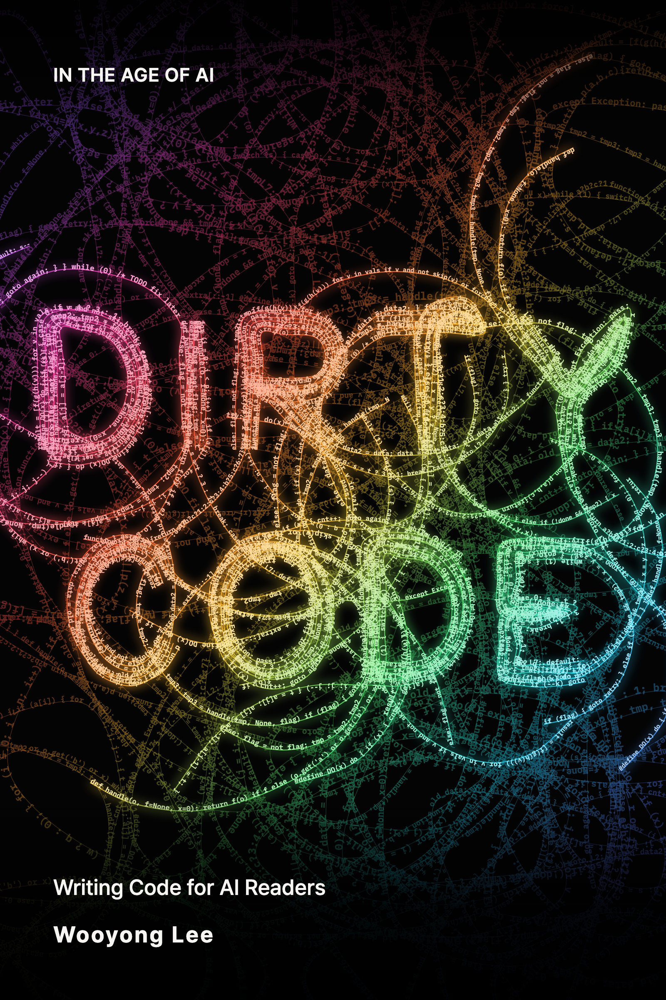

  

IN THE AGE OF AI

<h1 align="center">Dirty Code</h1>

  <b>English</b> &nbsp;·&nbsp; <a href="README.ko.md">한국어</a>

  <b>AI writes the code. People write the guarantees.</b> 
  We learned to write code for people. Now we write it for AI.

 

## Pop the hood and all you see is a cover

On an older car, you opened the hood and saw the parts. You could see a worn belt or an oil leak, and you fixed it with a wrench.

Open the hood of a modern car and you see a plastic cover. You can't tell what's wrong by looking. But plug a scan tool into the diagnostic port under the dashboard, and the fault comes up as a code, such as "P0303: cylinder 3 misfire." Nobody built the car carelessly. Mechanics now plug in the scan tool before they look, so cars are built for the scan tool to read.

The same thing is happening to code. Of the code merged into your repository today, how many lines did you read one by one? When you tell an AI "fix this bug," the one who finds the related code and reads it first is the AI, not you. This book starts there. **When you hand a task to an AI, the AI reads your code before you do.**

*Dirty Code* is about writing code that this reader, the AI, can read and change well. It is also about what people should do instead, once they stop reading code line by line.

> Mechanics call the fault codes on a scan tool **DTCs**: Diagnostic Trouble Codes. 
> In this book, DTC stands for **D**ir**t**y **C**ode.

## Three questions

1. **What does code look like when AI can read it and change it well?** 
   Names, where code lives, duplication, comments, error messages, folder structure, and prompts. (Part II)
2. **If people no longer read the code, how do they guarantee quality?** 
   They split the work, decide what must never break, and design how to check it. (Part III)
3. **Is it true, and how far does it go?** 
   We build the same feature in two shapes, ask AI to change both, and compare the numbers. We also cover the moments when people still have to read the code. (Part IV)

This book does not cover how to use AI tools, model rankings, or the future of jobs.

## Contents

Every chapter is still in preparation. Published chapters will be linked here.

**Preface.** To *Clean Code*: we learned to write code for people

**Part I. The reader of your code has changed**

1. "My way used to be faster": the day developers stopped reading code
2. AI doesn't remember the code it read yesterday
3. What carries over from *Clean Code*, and what changes

**Part II. Code for the scan tool**

4. AI guesses what a function does from its name
5. Keep what changes together on one screen
6. When a copy is safer than a shared function
7. Comments say why: AI tidies up numbers it can't explain
8. Every hop through a function is a chance for AI to get lost
9. Install a diagnostic port: errors and logs for AI to read
10. The map AI navigates by: folder names and an index file
11. Prompts are code that AI reads

**Part III. People install the warning lights**

12. Where to cut: hand off work in pieces you can check
13. People decide what must never break when things run at once
14. How to check code without reading a line of it
15. How to have AI inspect the code AI wrote

**Part IV. Is it true, and how far does it go?**

16. The experiment: one feature, two engine bays
17. When the GPS is wrong: the moments people must read code
18. Can we skip the code? We asked AI to write machine code directly

**Closing.** AI writes the code. People write the guarantees.

## Every chapter follows the same order

1. **Scene**: a situation everyone has been in
2. **Claim**: one sentence
3. **Why**: derived from "AI reads everything for the first time, every time"
4. **Code**: the version for people next to the version for AI
5. **Prompt**: what AI opened and changed when given the same task
6. **Evidence**: an experiment or a case from real work
7. **What people do**: something you can do tomorrow
8. **Where it breaks**: the cases where the claim does not hold

## Every claim comes with an experiment

- We build the same feature in two shapes. The behavior and the tests are identical. Only the shape of the code differs.
- We send the same request to a fresh session at least ten times.
- Success is judged by tests the AI never sees.
- Every result is recorded with its date and model name, because the numbers change when the model changes.

The experiment plan is in [experiments/](experiments/README.md) (in Korean for now).

## On *Clean Code*

Robert C. Martin's *Clean Code* set the standard for code that people read. This book does not argue against it. It looks at what stays the same and what changes when the reader is different. Some things, like names and tests, matter even more.

## Status

- November 2026: the outline and experiment plan are set, and writing has begun.
- The manuscript is written in English first. A Korean edition follows, rewritten for Korean readers.

New chapters will appear in this repository. Turn on **Watch** to hear about them. A **Star** tells the author how many readers are waiting.

---

© 2026 Wooyong Lee. All rights reserved. Please credit the source when quoting.
